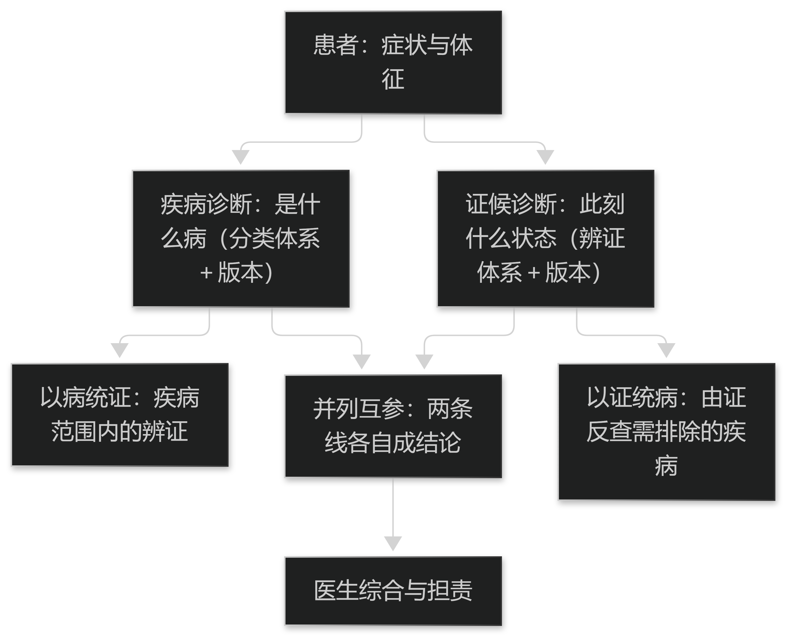

# 第25章 两套诊断体系的并存

## 25.1 体系差异与互参

### 25.1.1 疾病诊断与证候诊断的关系

疾病诊断回答"是什么病"——以病因、病理与可检验指标为依据，追求同一疾病在不同患者间的可比；证候诊断回答"此刻是什么状态"——以四诊信息为依据，追求同一患者在不同时点间的可辨。两者回答的并不是同一个问题。

因此二者**既不互斥也不互相替代**：同一疾病可有不同证候，同一证候也可出现在不同疾病（见篇1 §2.2.1）。把二者强行合成一个标签集合，会让"比什么"变得说不清楚。

落到系统上，正确做法是**两个字段、各自带体系与版本**：疾病诊断写明所用分类体系及其版本与本地扩展，证候诊断写明所用辨证体系；两者的对应关系另表维护，不在数据层隐式合并。

> **要点**：疾病诊断答"是什么病"、证候诊断答"此刻什么状态"，二者非互斥亦非替代；系统须分列两个字段并各自声明体系与版本，对应关系另表维护，不得隐式合并。

**表25-1 疾病诊断与证候诊断的差别**

| 维度 | 疾病诊断 | 证候诊断 |
| --- | --- | --- |
| 回答的问题 | 是什么病 | 此刻是什么状态 |
| 主要依据 | 病因、病理与可检验指标 | 四诊信息与症状组合 |
| 稳定性 | 相对稳定，随病程阶段变化 | 随治疗与时点变化较快 |
| 可比性 | 同一分类体系内跨患者可比 | 跨患者可比性弱，重在自身前后对照 |
| 与治疗的关系 | 决定总体治疗方向 | 决定当下治则与方药加减 |

表25-1　共 5 行 × 3 列 · 来源：本书定义（篇10 §25.1.1；差别为体系层面的概括，不涉及具体临床指南）

<figure><figcaption>
两套诊断体系的关系与互参模式
</figcaption></figure>

### 25.1.2 互参的三种模式与风险

两套体系互参有三种常见模式：**以病统证**（先定疾病，再在疾病范围内辨证）、**以证统病**（从证候出发，反查需排除的疾病）、以及**并列互参**（两条线各自给出结论，再由医生综合）。

三种模式的风险各不相同：以病统证容易把疾病范围内的常见证候当作全部可能，漏掉需要排除的他病；以证统病容易忽视证候缺乏特异度，把常见证候误导向严重疾病；并列互参则容易把两条独立结论堆给医生，反而加重判断负担。

选择的依据是**场景的风险结构**：风险高的场景（危重鉴别）宜并列互参并把安全项前置；风险低、病程长的场景（慢病调理）用以病统证更省力。不存在普适最优的模式。

> **要点**：互参有以病统证、以证统病、并列互参三种模式，风险分别是漏排他病、常见证候误导向重病、结论堆叠加重负担；选择依据场景风险结构，无普适最优。

## 25.2 数据的对齐

### 25.2.1 编码体系的对齐

结合的工程前提是**两套编码能对得上**。疾病侧通常已有成熟的分类与编码体系，中医侧则有病名、证候名与治则名三套术语（见篇3 §8.2）。

对齐表必须写明的字段有四项：**本侧术语、对侧术语、对应关系类型（一对一／一对多／无对应）、生效版本与日期**。其中"无对应"必须**显式登记**而不是留空——留空会被下游当成"尚未映射"，与"确定无对应"混为一谈。

需要接受的是，相当一部分中医术语在对方体系里确实**没有对应**。强行给出映射会制造虚假精确；正确做法是登记为无对应，并让下游按既定的缺省策略处理。

> **要点**：对齐表须写明本侧术语、对侧术语、关系类型（含显式"无对应"）、生效版本与日期；"无对应"必须登记而非留空，且应接受确有无法对应者，强行映射即制造虚假精确。

**表25-2 编码对齐表必须包含的字段**

| 字段 | 作用 | 缺失后果 |
| --- | --- | --- |
| 本侧术语 | 保留原始表述 | 无法回溯，医生不认自己的记录 |
| 对侧术语 | 对齐目标 | 无法跨体系检索 |
| 关系类型 | 一对一／一对多／无对应 | "无对应"与"未映射"被混为一谈 |
| 生效版本与日期 | 保证历史数据含义稳定 | 历史结论的含义随时间漂移 |
| 复核人与依据 | 可追责、可复核 | 映射错误无法定位来源 |

表25-2　共 5 行 × 3 列 · 来源：本书定义（篇10 §25.2.1；关系类型中的"无对应"须显式登记，不得留空）

### 25.2.2 检查结果与四诊信息的时序对齐

两套体系的观察发生在不同时点：检验与影像有明确的采样时刻，四诊信息则是"一次就诊"的整体印象。把二者并置而不写时间，等于把不同时刻的状态当成同一时刻。

最小要求是**可追溯标识**：患者标识、就诊号、采样或观察时间、采集设备或方法版本（见篇2 §6.2.1）。时序对齐的意义在于能回答"这个舌象与那份检查报告，是同期还是隔了一周"。

对病程短、变化快的场景，时序错位会直接改变结论；对慢病随访场景，则应保留**多次观测的序列**而不是只取最近一次——变化的趋势往往比绝对值更有信息。

> **要点**：两套体系的观察时点不同，须以患者标识、就诊号、时间、设备方法版本做可追溯对齐；急性场景时序错位会改变结论，慢病场景应保留多次观测序列而非只取最近一次。
