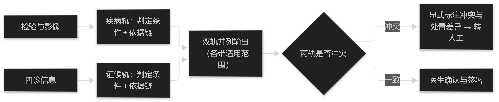

# 第26章 结合的落地路径

## 26.1 病证结合模型

### 26.1.1 以病统证与以证统病的建模差异

建模上的差别在于**谁决定输出空间**。以病统证先做疾病分类，再在该疾病的证候子集内做多分类：输出空间小、样本集中，指标容易做好，代价是疾病判错则证候必然跟着错。

以证统病直接输出证候，再由对应表给出需排除的疾病清单：输出空间大、类别不平衡严重，指标通常难看；好处是证候判定不会因疾病误判而系统性偏移，且更接近中医自身的推理顺序。

若两者都要，应做成**双轨**而不是单轨融合：各自独立输出，在结论层并列呈现并显式标注冲突（见篇4 §11.2.2 的分工纪律）。单轨融合会把两条链的错误叠加，且出问题时难以定位是哪一轨。

> **要点**：以病统证由疾病决定输出空间（指标易好但错误会传导），以证统病保留中医推理顺序（指标难看但不被疾病误判污染）；两者兼得应做双轨并列输出并标注冲突，不做单轨融合。

**表26-1 以病统证与以证统病的取舍**

| 维度 | 以病统证 | 以证统病 | 建议 |
| --- | --- | --- | --- |
| 输出空间 | 疾病内的证候子集 | 全证候集合 | 视数据量决定 |
| 指标表现 | 通常较好 | 通常较差 | 不可据此判断优劣 |
| 错误传导 | 疾病判错则证候必错 | 不被疾病误判污染 | 高安全场景倾向后者 |
| 样本需求 | 相对小 | 大且易不平衡 | 数据有限时倾向前者 |
| 与中医推理顺序 | 相反 | 一致 | 教学场景宜后者 |

表26-1　共 5 行 × 4 列 · 来源：本书定义（篇10 §26.1.1；指标差异来自输出空间与类别分布，不代表方法优劣）

<figure><figcaption>
病证结合的双轨输出
</figcaption></figure>

### 26.1.2 输出与解释的双轨

双轨输出不是把两份结论拼在一页，而是**每一条都带自己的依据链**：疾病轨给出所依据的检验与影像及其判定条件，证候轨给出所依据的四诊要素及其判定条件（见篇4 §12.2.1 的四件套）。

冲突要显式呈现而不是内部消化：例如"检查提示感染、四诊提示表证初起"时，系统应并列展示并标明二者指向不同处置，由医生判断。

解释的措辞也要分轨：对患者解释疾病侧可用通用说法，解释证候侧则应说明"这是根据你整体表现作出的状态判断，会随治疗变化"——避免把证候表述成不可变的疾病标签。

> **要点**：双轨输出要求每轨自带依据链（疾病轨＝检验影像＋判定条件，证候轨＝四诊要素＋判定条件）；冲突须并列展示并标注处置差异，解释措辞分轨且不得把证候说得像疾病标签。

## 26.2 场景与评价

### 26.2.1 典型场景

三个最可落地的场景各有侧重：**治未病与体检**偏重风险提示与生活方式建议，证候侧输出应保守，不作疾病断言；**慢病随访**偏重趋势，模型价值在变化检测而非单次判定；**专病门诊**偏重病证对应，适合用以病统证的建模。

场景选择本身就是一种约束设计：同一套模型在不同场景下的**输出权限**应当不同——体检场景可只给"建议复查"，专病场景才给具体证候。

反过来，把在专病数据上做好的模型直接搬到体检场景，几乎必然出现过度诊断：输出权限没有随之收紧，而人群的基础概率已经变了。

> **要点**：治未病／体检、慢病随访、专病门诊三场景侧重不同（风险提示／变化检测／病证对应），同一模型须按场景调整输出权限；把专病模型直接搬到体检场景会因基础概率变化造成过度诊断。

### 26.2.2 评价与合规的双重要求

结合系统要同时满足两套评价口径：疾病侧按分类指标评（见篇5 §13.2.1 的成组报告要求），证候侧按与参照体系的一致性评，两者**不得互相替代**——疾病侧指标高，并不能证明证候侧可用。

合规上应明确**预期用途**：若系统输出疾病诊断提示，其风险与医疗器械管理要求通常高于仅输出证候提示（见篇5 §15.2.2）。用途表述决定合规路径，也决定界面必须写什么。

因此上线材料应包含两份适用范围声明：一份面向疾病侧、一份面向证候侧，分别写明适用人群、设备条件与不适用情形。合并成一句话的适用范围，等于没有适用范围。

> **要点**：结合系统须满足两套评价口径（疾病侧成组分类指标、证候侧与参照体系一致性）且不可互替；合规按预期用途定路径，疾病侧提示风险更高；上线须有两份分轨适用范围声明，合并成一句等于没有。

**表26-2 分轨适用范围声明必须写明的内容**

| 声明项 | 疾病侧 | 证候侧 |
| --- | --- | --- |
| 适用人群 | 与建库人群构成一致者 | 同左，并注明体质与年龄分布 |
| 设备与条件 | 明确的检验与影像条件 | 明确的四诊采集条件 |
| 输出性质 | 提示，非确诊 | 状态判断，随治疗变化 |
| 不适用情形 | 急诊与危重、特殊人群 | 急危重症、认知障碍者 |
| 更新与失效 | 依分类体系版本 | 依辨证体系与术语表版本 |

表26-2　共 5 行 × 3 列 · 来源：本书定义（篇10 §26.2.2；两轨分别签署，不得合并为一条）
