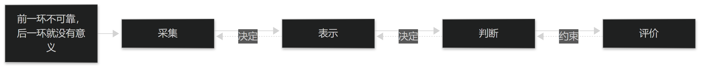

# 第1章 学科定位与研究对象

## 1.1 定义与研究边界

### 1.1.1 定义的三个要点

中医智能诊断学是研究"如何用可计算的方法辅助中医诊断"的学科。它的定义有三个要点：**对象是中医诊断**（不是替代中医理论），**手段是可计算方法**（采集、表示、建模、评价），**目标是辅助而非取代**（人仍是判断的主体）。

这三条决定了它的边界：凡是不能落到"可采集、可表示、可复核"的诊断环节，都不在本学科能解决的范围之内。

把它理解为"给中医诊断加一套可验证的工程方法"，比理解为"用 AI 学会中医"更准确，也更有用。

> **要点**：定义三要素——对象是中医诊断、手段是可计算方法、目标是辅助而非取代；三者共同划出学科边界。

### 1.1.2 与相关学科的关系

它站在三门学科的交叉处：**中医诊断学**提供理论对象与术语体系，**医学信息学**提供数据与系统方法，**人工智能**提供模型与评价手段。

三者的分工必须清楚：中医诊断学回答"诊断是什么、凭什么"，信息学回答"数据怎么存与怎么流"，AI 回答"从数据到结论用什么方法、怎么验证"。

常见的偏差是让某一门压倒其余两门——只讲模型不讲诊断依据，或只讲诊断不改数据条件，都会让成果落不了地。

> **要点**：三门学科分工不可互压——诊断学给依据、信息学给数据与系统、AI 给方法与验证；偏一侧成果就落不了地。

## 1.2 基本任务与限度

### 1.2.1 它解决什么问题

本学科解决四类问题：**采集**（把四诊信息变成可记录的数据）、**表示**（把数据变成可比较的特征）、**判断**（把特征变成有依据的结论）、**评价**（证明这个结论在什么条件下可信）。

四类问题是递进的：没有规范的采集，表示就没有意义；没有稳定的表示，判断就无法复现；没有评价，判断就不能用于临床。

因此本教材按"采集—表示—模型—评价—落地"的顺序组织，而不是按技术流行度组织。

> **要点**：四类任务递进——采集→表示→判断→评价；前一环不可靠，后一环就没有意义。

<figure><figcaption>
四类任务链：采集—表示—判断—评价
</figcaption></figure>

### 1.2.2 它不解决什么问题

它**不能**解决：中医理论本身的争议（如某证候是否独立存在）、缺少记录的临床经验（无法计算未记录的东西）、以及价值判断（这个患者最要紧什么，只能由人与患者决定）。

同样，它也不能把"不可复现的观察"变成可靠输入——若同一舌象两位医生描述不同，模型学到的只是标注噪声。

把这些限度写在前面，是为了避免一种典型的失望：把工具的能力边界当成工具的缺陷。**本节的三条限度贯穿全书。**

> **要点**：不解决理论争议、未记录的经验与价值判断；把限度写在前面，避免把工具边界当成工具缺陷。

**表1-1 本学科不解决的三个问题**

| 问题 | 为什么不能解决 | 应当怎么做 |
| --- | --- | --- |
| 理论争议 | 某证候是否独立存在属学术问题，非计算问题 | 如实标注所依据的体系与版本 |
| 未记录的经验 | 无法计算没有记录下来的东西 | 先改采集规范，再谈建模 |
| 价值判断 | 最要紧的是什么只能由人与患者决定 | 系统提供信息，决定权留给人 |

表1-1　共 3 行 × 3 列 · 来源：本书定义（篇1 §1.2.2）
