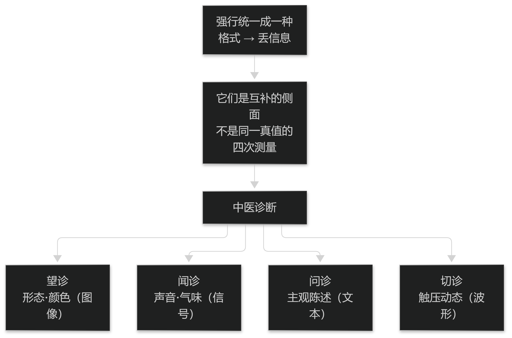

# 第2章 中医诊断的基本原理

## 2.1 四诊合参与整体审查

### 2.1.1 四诊信息的类型与互补性

四诊提供的是**类型不同**的信息：望诊偏形态与颜色（图像）、闻诊偏声音与气味（信号）、问诊偏主观陈述（文本）、切诊偏触压动态（波形）。

它们不是"同一真值的四次测量"，而是**互补的侧面**：舌象可以客观记录而患者自述不可客观化，脉象信息密度高但取得方式依赖手法。

理解这一点直接决定技术路线：不同类型的信号需要不同的采集与表示方法，强行统一成一种格式会丢信息（见篇3）。

> **要点**：四诊是互补的侧面而非同一真值的四次测量；强行统一成一种格式就丢信息。

### 2.1.2 权重取舍的临床逻辑

临床上"舍脉从症"或"舍症从脉"是常见的判断：某一诊的信息与其余三诊冲突时，医生会依据经验决定信谁。

这类取舍**有临床逻辑但没有统一公式**：它依赖具体病种、病程阶段与既往经验，且不同医生可能不同。

对智能诊断的含义是：不要试图用固定权重复制这种动态取舍，而应当**把冲突显式暴露**出来，提示"此处征象不一致"，由医生决定信谁（见篇6 §12.2）。

> **要点**：取舍（舍脉从症）有临床逻辑但无统一公式；系统应暴露冲突、由医生决定信谁，而不是用固定权重替医生取舍。

<figure><figcaption>
四诊信息的类型与互补性
</figcaption></figure>

## 2.2 辨证的体系与层次

### 2.2.1 主要辨证体系

中医辨证存在多套并行体系：**八纲**（阴阳表里寒热虚实）、**脏腑**、**六经**、**卫气营血**、**三焦**，以及气血津液等。它们各有适用范围，互相补充而非互斥。

对计算而言，"多体系并行"是重要约束：不存在唯一的证候真值，同一病例在八纲与脏腑体系下的结论表述不同。

因此任何"证候识别"任务都必须先声明**以哪套体系、哪个版本的标准为准**（见篇2 §2.2.2 与表2-1）。

> **要点**：辨证体系多套并行，不存在唯一证候真值；任何识别任务必须先声明以哪套体系与哪个版本为准。

**表2-1 主要辨证体系与适用说明**

| 体系 | 主要维度 | 使用注意 |
| --- | --- | --- |
| 八纲 | 阴阳、表里、寒热、虚实 | 最通用，常作初步定位 |
| 脏腑 | 脏腑功能与病位 | 需与八纲配合，避免单用 |
| 六经 | 太阳至厥阴六阶段 | 多用于外感病程 |
| 卫气营血 / 三焦 | 病程层次 | 多用于温病 |
| 气血津液 | 物质与功能状态 | 常作兼夹描述 |

表2-1　共 5 行 × 3 列 · 来源：本书定义（篇1 §2.2.1；体系名称为教材通行分类，序号顺序不作唯一性主张）

### 2.2.2 证候的层次与主兼夹

证候不是一个平坦的清单，而有层次：**主证**决定治法方向，**兼夹证**影响加减与取舍，**基础体质**提供背景（如素体阳虚）。

这一层次结构直接决定模型的输出形式：只输出一个证候名是不够的，必须能表达"主证 + 兼夹 + 依据 + 不确定度"。

忽略层次会把不同的临床情况压成同一个标签，从而在评价时出现"指标不错但医生不用"的结果（见篇6）。

> **要点**：证候有层次——主证定方向、兼夹定加减、体质为背景；只输出一个证候名远远不够。
