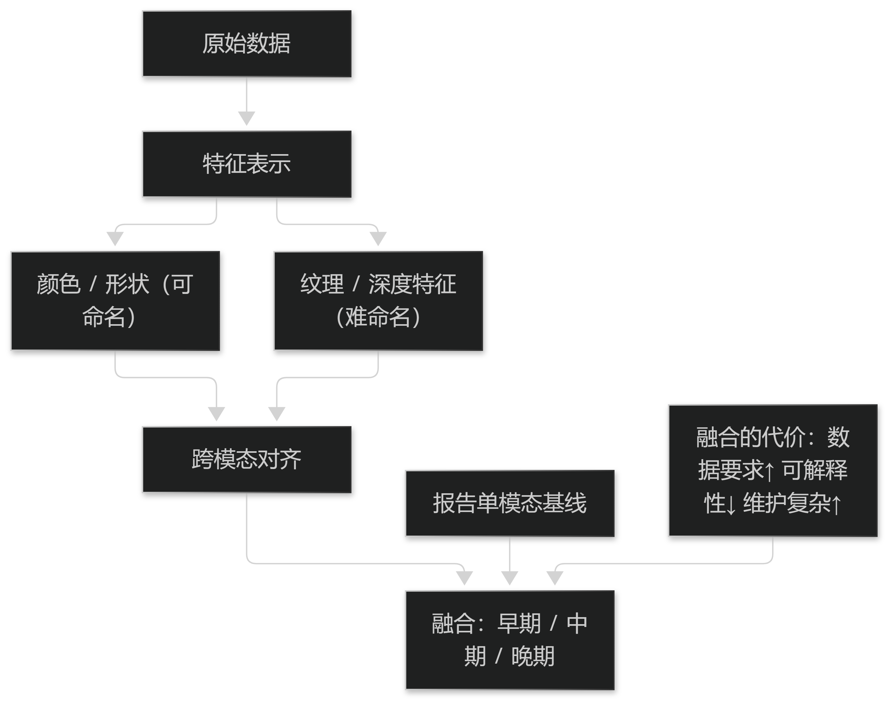

# 第9章 表示对齐与融合

## 9.1 跨模态对齐

### 9.1.1 时间对齐与语义对齐

对齐分两个层次：**时间对齐**（各模态数据属于同一次就诊与同一时段）与**语义对齐**（各模态指向同一个观察单元，如"舌象的苔色"与"问诊的口干"）。

时间对齐靠标识与时间戳，语义对齐靠**观察单元的定义**：必须先约定"一次就诊由哪些采集动作构成、各自的时效要求是什么"。

没有这个约定，融合就是把不同时间、不同对象的数据拼在一起，结论不可解释。

> **要点**：对齐分时间与语义两层；语义对齐取决于"观察单元"的定义，没有这个约定融合就不可解释。

### 9.1.2 缺失模态的处理

实际数据中模态缺失是常态（患者未能配合伸舌、设备临时故障、问诊未问及某项）。处理方式有三种：**丢弃该样本**（损失数据）、**补全**（引入推测）、**按可用模态建模并标注缺失**（推荐）。

推荐第三种的原因是可追溯：结论基于哪些信息是明确的，医生可以据此判断可信度。

补全只在缺失机制清楚且有验证的前提下使用，且必须标注为补全值——否则会把推测当成观察。

> **要点**：缺失模态首选"按可用模态建模并标注缺失"；补全只在机制清楚且有验证时使用，且必须标注为补全值。

## 9.2 融合策略

### 9.2.1 早中晚期融合

**早期融合**（在特征层拼接）：简单、但要求模态同质且缺失难处理；**中期融合**（各模态先编码再联合）：灵活性好、是当前主流；**晚期融合**（各模态各自出结论再加权）：鲁棒性好、但丢失模态间交互信息。

选择依据是"模态间的信息是否互补且需要交互"：舌象与脉象在辨证中相互印证，属需要交互的类型，倾向中期融合。

无论哪种，都要报告**单模态基线**，否则无法说明融合是否真的带来增益。

> **要点**：早/中/晚期融合各有取舍；判断依据是模态间是否需要交互；无论哪种都要报告单模态基线。

**表9-1 三种融合策略的取舍**

| 策略 | 优点 | 主要代价 |
| --- | --- | --- |
| 早期融合（特征层） | 实现简单 | 要求模态同质，缺失难处理 |
| 中期融合（编码层） | 灵活，可处理异质模态，是当前主流 | 需要更多配对数据 |
| 晚期融合（结论层） | 鲁棒，单模态故障影响小 | 丢失模态间交互信息 |

表9-1　共 3 行 × 3 列 · 来源：本书定义（篇3 §9.2.1）

<figure><figcaption>
特征表示与融合的层次
</figcaption></figure>

### 9.2.2 融合的代价与选择

融合带来三个代价：**数据要求更高**（需同步采集多模态）、**可解释性更差**（结论来自何处不直观）、**维护更复杂**（任一模态故障影响整体）。

因此工程上的正确提问不是"能不能融合"，而是"融合换来的增益是否值得这些代价"。若单模态已达标，融合只增加风险。

决策应写成**可复核的记录**：融合方案、单模态基线、增益幅度、以及未采用融合的理由。

> **要点**：融合的代价是数据要求更高、可解释性更差、维护更复杂；应记录增益幅度与"未采用融合的理由"。
