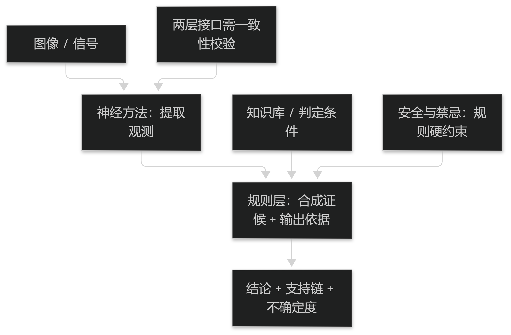

# 第11章 深度学习与知识驱动

## 11.1 深度模型

### 11.1.1 面向图像与信号的网络

图像任务（舌体分割、苔质分区、面色分区）适合卷积网络及其分割变体；信号任务（脉象波形）适合一维卷积或循环网络；两者也可统一为多通道输入。

这类模型的核心优势是**省去了手工特征设计**，在标注充足时精度高。代价是对数据量与标注质量依赖强，且学到的表示难以命名。

因此深度模型适合做"感知层"（从像素与波形到中间表示），是否让它直接输出证候结论需要谨慎（见 §11.2.2）。

> **要点**：深度模型适合做感知层（像素/波形→中间表示），直接输出证候结论需谨慎。

### 11.1.2 小样本与迁移学习

中医四诊数据集的规模通常远小于通用视觉数据集，小样本是常态。可行手段包括：**迁移学习**（用通用预训练模型初始化）、**数据增强**（限定在物理上合理的变换内）、以及**弱监督**（利用粗略标注）。

关键纪律是**增强必须符合采集物理**：对舌象做水平翻转、随意变色会造出不存在的样本，训练出对真实变化不敏感的模型。

小样本下的结论天然脆弱，必须用外部数据验证（见篇5 §13.2）。

> **要点**：小样本是常态，可用迁移与弱监督；增强必须符合采集物理，翻转/变色会造出不存在的样本。

## 11.2 知识与推理

### 11.2.1 知识图谱与本体

把中医的概念与关系组织成图谱（实体：症状、证候、治法、方药；关系：支持、兼夹、对应）可以让模型**引用显式知识**，而不是从数据里隐式猜。

图谱的价值在"约束输出空间"：证候结论必须落在图谱定义的证候集合内，且必须给出支持它的实体路径。

建图的关键是**版本与出处**：每条边都要能回答"依据什么、何时生效"（见篇7 §20.2）。

> **要点**：图谱的价值是约束输出空间并给出支持路径；每条边都要能回答"依据什么、何时生效"。

### 11.2.2 规则与神经方法的结合

实用架构通常是**神经感知 + 规则约束**：前者从图像与信号中提取观测，后者依据判定条件组合成证候结论并输出依据。

这种分工的好处是各取所长，且把可解释性放在规则层（可审阅、可修改），而不是要求神经网络自证。

风险是两层之间的接口成为新的黑箱：必须定义"观测以什么形式交给规则层"，并对该接口做一致性校验（见篇6 §17.1）。

> **要点**："神经感知+规则约束"各取所长；两层之间的接口是新风险点，必须定义形式并做一致性校验。

**表11-1 神经方法与知识方法的适用分工**

| 环节 | 建议承担者 | 理由 |
| --- | --- | --- |
| 从图像/信号提取观测 | 神经方法 | 节省手工特征，精度高 |
| 判定条件与证候合成 | 规则 / 知识库 | 可审阅、可修改、可给依据 |
| 安全与禁忌检查 | 规则（硬约束） | 必须确定、可审计，不容概率 |
| 表示学习（中间层） | 神经方法 | 难以人工设计 |

表11-1　共 4 行 × 3 列 · 来源：本书定义（篇4 §11.2.2）

<figure><figcaption>
神经感知 + 规则约束的分工
</figcaption></figure>
