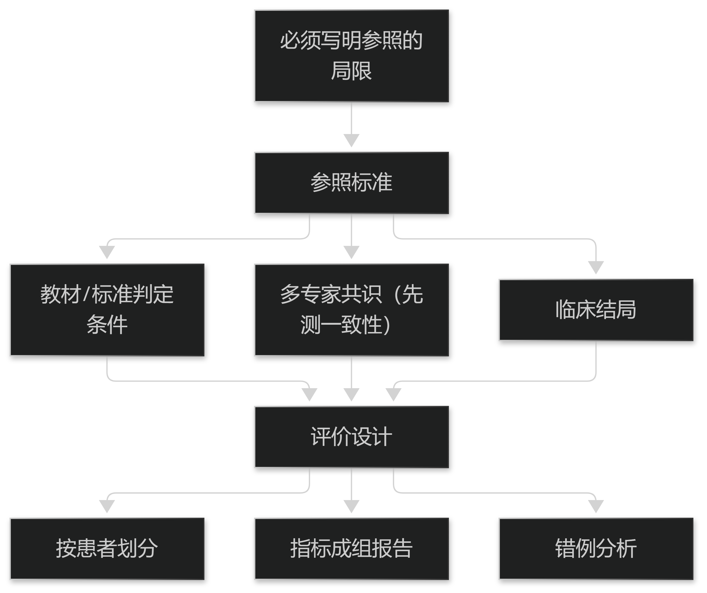

# 第13章 评价的基础问题

## 13.1 金标准之困

### 13.1.1 参照标准的选择

诊断模型的性能以"与参照标准的一致程度"衡量，但中医诊断**缺少唯一金标准**：证候判断依赖医家经验与流派，不同专家的结论可以不同。

可行的替代参照有三类：**教材或标准给出的判定条件**（可复现但可能脱离临床）、**多专家共识**（需报告一致性）、以及**临床结局**（滞后但最贴近价值）。

选择哪一类必须在评价方案中写明并说明其局限——把"与某位专家一致"表述为"准确"是最常见的过度声明。

> **要点**：中医诊断无唯一金标准；参照只能用"教材判定条件/多专家共识/临床结局"三类，且必须写明局限。

**表13-1 三类参照标准的比较**

| 参照类型 | 优点 | 局限 |
| --- | --- | --- |
| 教材 / 标准判定条件 | 可复现、可审核 | 可能脱离真实临床 |
| 多专家共识 | 贴近临床经验 | 须先测一致性，成本高 |
| 临床结局 | 最贴近价值 | 滞后、受混杂影响大 |

表13-1　共 3 行 × 3 列 · 来源：本书定义（篇5 §13.1.1）

<figure><figcaption>
参照标准的选择与评价设计
</figcaption></figure>

### 13.1.2 多专家一致性

当参照来自多位专家时，先要测量**专家之间的一致性**（如一致性系数）。若专家之间本身不一致，模型的"与参照一致率"上限就被压低了，此时追求高准确率没有意义。

一致性的处理有两种取向：只保留一致病例作为测试集（提高参照可靠性、但使测试集偏向简单病例），或保留全量并报告分歧病例上的表现。

推荐后者并**单列分歧子集**的结果——它往往才是真正有信息量的部分。

> **要点**：参照来自多专家时先测一致性；专家本身不一致则准确率上限被压低，此时应单列"分歧子集"结果。

## 13.2 指标与实验设计

### 13.2.1 分类与排序指标

分类指标（准确率、敏感度、特异度、F1）必须成组报告：单独报告准确率在类别不平衡时会严重误导（罕见证候占比低时，全判为常见证候也能得高准确率）。

排序指标（曲线下面积）反映"把正确结论排在前面"的能力，更适合"给候选结论排序"的场景。

无论用哪组指标，都应同时给出**混淆明细**与**典型错例**——后者对理解边界比数字更有用。

> **要点**：分类指标必须成组报告（单报准确率在类别不平衡时严重误导）；并给混淆明细与典型错例。

**表13-2 必须成组报告的指标**

| 指标组 | 包含 | 注意 |
| --- | --- | --- |
| 分类指标 | 敏感度、特异度、准确率、F1 | 单报准确率在类别不平衡时误导 |
| 排序指标 | 曲线下面积 | 适合"给候选排序"的场景 |
| 辅助材料 | 混淆明细、典型错例 | 错例比总体指标更能说明边界 |

表13-2　共 3 行 × 3 列 · 来源：本书定义（篇5 §13.2.1）

### 13.2.2 划分与外部验证

数据划分必须**按患者划分而非按记录**：同一患者的多次就诊若分处训练与测试，会因个体特征重复而虚高指标。

更强的证据来自**外部验证**：在未参与开发的其他机构、其他设备、其他人群上测试，并报告与内部测试的差距。

仅有内部验证的结果应明确标注为"内部验证"，不得表述为"可用于临床"。

> **要点**：划分必须按患者而非按记录；更强证据是外部验证；只有内部验证时不得声称"可用于临床"。
