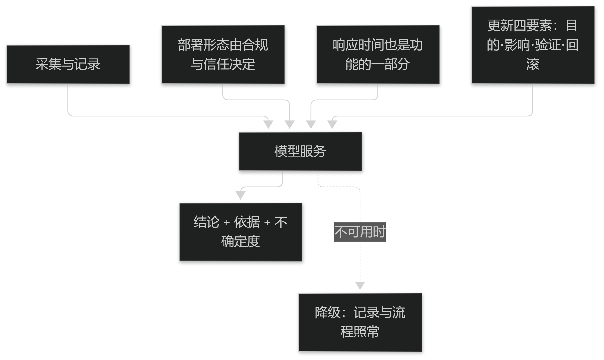

# 第17章 系统架构与集成

## 17.1 架构

### 17.1.1 模型服务与接口

模型应以**服务**形式提供：输入结构化的采集数据，输出结构化的结论（含依据与不确定度），并带版本号与耗时统计。

接口设计的三条纪律：**契约优先**（先定字段与错误码，再实现）、**幂等**（同一请求重复提交只生效一次）、**可降级**（模型不可用时系统仍能完成记录与流程）。

结论的字段应稳定且向后兼容，避免因模型升级导致下游解析失败。

> **要点**：模型以服务形式提供，输出含依据与不确定度；接口三纪律：契约优先、幂等、可降级。

**表17-1 模型服务的三条接口纪律**

| 纪律 | 要求 | 检查点 |
| --- | --- | --- |
| 契约优先 | 先定字段与错误码再实现 | 契约文档与版本号齐备 |
| 幂等 | 同一请求重复提交只生效一次 | 重复提交测试通过 |
| 可降级 | 模型不可用时记录与流程照常 | 断服务演练通过 |

表17-1　共 3 行 × 3 列 · 来源：本书定义（篇6 §17.1.1）

### 17.1.2 与 HIS/EMR 的对接

与医院信息系统对接时，关键是**身份与主数据**：患者唯一标识与就诊号的对齐、术语与药品字典的映射必须先完成，否则后续数据无法归属。

对接范围建议"只读优先、写入受限"：先从系统取数据，回写仅限必要字段，并做幂等与对账。

对账要包含条数与关键字段，且失败须进入可重放的待处理队列，而不是静默丢弃。

> **要点**：对接的关键是身份与主数据对齐；范围"只读优先、写入受限"；对账含条数与关键字段，失败进可重放队列。

## 17.2 部署与运维

### 17.2.1 部署形态与降级

部署形态（院内独立、区域集中、混合）首先由**合规与信任**决定，而不是由技术便利决定。

无论哪种形态，都必须设计**降级路径**：模型服务不可用时，采集与记录应照常，结论缺失只影响辅助功能。

响应时间也是功能的一部分：医生等待超过一两秒就会跳过建议，速度不达标等于功能不存在。

> **要点**：部署形态由合规与信任决定；必须设计降级路径（模型不可用不影响记录）；响应时间也是功能的一部分。

<figure><figcaption>
系统架构与降级路径
</figcaption></figure>

### 17.2.2 更新与回滚

每次更新都应包含四要素：**目的、影响范围、验证方式、回滚预案**，缺一不可。

验证应包含**回归测试集**（典型病例 + 已知错误案例），确认旧问题未复现、新改动无副作用。

回滚判据必须可观测（如关键指标跌破阈值），且回滚操作应事先演练——事故当场才第一次尝试回滚是最危险的安排。

> **要点**：更新四要素缺一不可（目的/影响/验证/回滚）；验证须含回归测试集；回滚要事先演练且判据可观测。
