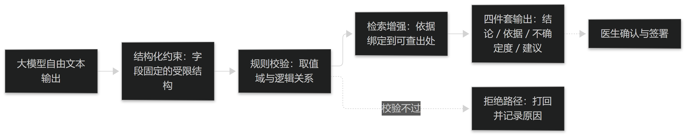

# 第23章 大模型与诊断的关系

## 23.1 能力与限度

### 23.1.1 改变了什么、没改变什么

大模型显著改变了**整理层**的工作：把自由文本抽取成结构化要素、把症状与术语对上号、把已有结论翻译成可读的解释，这些环节的成本与耗时都明显下降。

但它没有改变诊断任务的四个前提：**稳定可重复的输入**、**可比较的参照标准**、**可复核的输出**、以及**参照体系的选择**（见篇1 §1.2.1）。四条前提不因模型规模变大而自动满足。

因此判断一个"大模型诊断"项目是否成立，只需问三句：输入是否稳定可重复、判定条件能否写出并供人审阅、错误能否被独立发现。三问中任一为否，能力提升也不会转化为可用性提升。

> **要点**：大模型改变的是整理层（抽取、归一、解释），未改变诊断四前提（稳定输入、可比标准、可复核输出、参照体系）；判定层与责任层不能随之一并交出。

**表23-1 大模型与传统判别模型的差别**

| 维度 | 传统判别模型 | 大模型 | 使用纪律 |
| --- | --- | --- | --- |
| 输入形式 | 结构化特征向量 | 可容忍原始文本与图像 | 非结构化输入仍须固定采集条件 |
| 输出形式 | 固定类别与概率 | 自由文本，可附解释 | 必须约束为可校验结构 |
| 可复核性 | 系数或规则路径可读 | 生成路径不可复现 | 依据必须外挂（检索出处） |
| 错误形态 | 误判、置信度校准差 | 幻觉、看似合理的编造 | 事实性须独立核验 |
| 合适位置 | 判定层（有参照时） | 整理与解释层 | 不直接输出证候结论 |

表23-1　共 5 行 × 4 列 · 来源：本书定义（篇9 §23.1.1；差别为一般性描述，不针对特定产品）

### 23.1.2 生成式输出为何不可直接作结论

生成式输出优化的是"给定上下文下最可能的续写"，即流畅与合理，而不是**可追溯**与**可重复**——这与可复核判断的要求方向并不相同。

由此产生三类具体危害：**幻觉**（编出不存在的依据、方药或数值）、**顺随**（结论随提问措辞改变）、**不可复现**（同一输入两次输出不同）。三类危害不会因模型更强而消失，只会变得更难察觉。

在本书的口径里，生成式输出只能作为**候选与草稿**：进入流程前必须经过第12章的四件套检查（结论、依据、不确定度、建议动作，见篇4 §12.2.1），其中"依据"必须落到外部可查的出处，而不是模型自己写的解释。

> **要点**：生成式输出优化流畅与合理，不优化可追溯与可重复；幻觉、顺随、不可复现三类危害不因模型更强而消失，故只能作候选草稿，须经四件套检查且依据须外挂真实出处。

**表23-2 生成式输出的四类风险与对策**

| 风险 | 表现 | 检测方式 | 对策 |
| --- | --- | --- | --- |
| 幻觉 | 编造依据、方药或数值 | 依据溯源核验 | 依据须外挂真实出处并逐条可查 |
| 顺随 | 结论随提问措辞改变 | 同例改写提问重测 | 提问结构固定，不注入倾向 |
| 不可复现 | 同一输入多次输出不同 | 重复采样比对 | 固定参数与版本，输出留痕 |
| 越界 | 超出适用范围仍给结论 | 范围外样本测试 | 前置适用范围声明，范围外拒答 |

表23-2　共 4 行 × 4 列 · 来源：本书定义（篇9 §23.1.2）

## 23.2 可复核化的两条路径

### 23.2.1 检索增强：把依据绑到出处

检索增强的实质不是"让模型更懂中医"，而是**把回答约束在可查的语料上**：先取回相关段落，再据其作答，并把出处与答案一并输出。

落地有三个要点：语料要先定**版本与范围**（教材、标准、指南各占多少，须写明）；切分粒度要与**观察单元**一致（篇3 §9.1.1 的约定在此同样适用）；输出必须带出处，而不是只给一个置信度。

需要清醒的是，检索增强**降低而不消除**幻觉的代价：引用错源、张冠李戴仍会发生。因此出处必须可点开逐条核对，且引用错误要能被独立发现——做不到这一点，检索只是把不可复核换成了"看起来可复核"。

> **要点**：检索增强的实质是把回答约束在可查语料上，先取回再作答并输出出处；语料版本、切分粒度、出处可核三点缺一不可，它降低而非消除幻觉。

<figure><figcaption>
大模型输出的可复核化路径
</figcaption></figure>

### 23.2.2 结构化约束：把输出锁进可校验格式

自由文本无法直接进入流水线。可行做法是让模型输出**受限结构**——字段固定、取值受字典约束的结构化数据，再由规则层校验其取值域与逻辑关系。

结构应复用本书既有口径：要素三元（症状—部位—程度，见篇3 §8.1.2）与判定条件四段式（要素＋取值＋逻辑关系＋出处，见篇4 §12.1.1）。复用的意义在于让大模型输出与既有系统**同构**，可拼装、可审计、可回溯。

校验必须带**明确的拒绝路径**：字段缺失、取值超出字典、逻辑冲突一律打回，并记录打回原因。打回率本身是评估这套方案是否可用的指标——打回率长期偏高，说明提示或词典没有对齐，而不是模型"不够聪明"。

> **要点**：结构化约束＝让模型输出字段固定的受限结构，再由规则层校验取值域与逻辑；应复用要素三元与判定条件四段式以保持同构，并保留拒绝路径，把打回率当作可用性指标。
