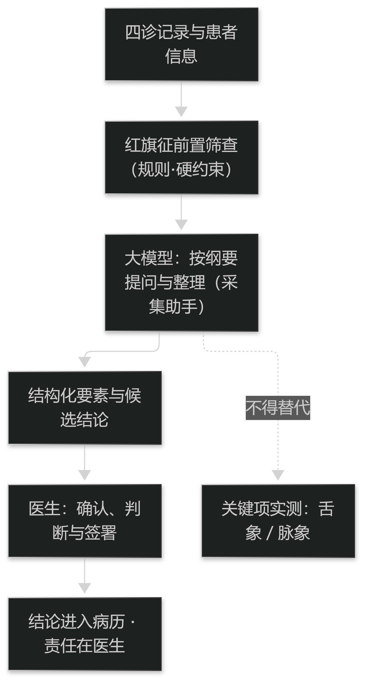

# 第24章 大模型进入诊断流程

## 24.1 人机分工与交互设计

### 24.1.1 机器提问与整理，人确认与负责

大模型在诊断流程中的合理位置是**采集助手与整理助手**：按问诊纲要逐项提问、把自由记录整理成要素、把已有结论翻译成患者能懂的话。

而**确认与负责**不能交给模型。系统给建议、医生作决定、医生担责（见篇5 §15.1.2）——这条不因模型的参与而改变，只会在界面上变得更需要写明。

因此分工要落进界面文案与制度：模型的每一处输出都应标明性质（"整理结果"或"候选建议"），并按"提示／可考虑／需复核"分级措辞；含安全含义的项一律归入"需复核"。

> **要点**：大模型的合理位置是采集助手与整理助手；确认与负责留在医生，模型输出须在界面标明性质并按提示／可考虑／需复核分级，安全项一律需复核。

**表24-1 大模型在诊断流程中的任务分工**

| 环节 | 适合交给大模型 | 必须由人或规则承担 | 理由 |
| --- | --- | --- | --- |
| 问诊采集 | 按纲要提问、补全缺失要素 | 关键项实测（舌象、脉象） | 自述不能替代观察 |
| 记录整理 | 自由文本抽取为要素三元 | 术语归一映射的审定 | 映射须有版本且可审计 |
| 候选生成 | 生成候选证候与鉴别项 | 判定条件与主兼夹顺序 | 判定须可写出、可审阅 |
| 解释沟通 | 把结论转为患者能懂的话 | 结论确认与责任签署 | 责任不能转移给系统 |
| 安全筛查 | 提醒易漏项、做交叉检查 | 红旗征清单与触发动作 | 安全项须确定、可审计 |

表24-1　共 5 行 × 4 列 · 来源：本书定义（篇9 §24.1.1）

<figure><figcaption>
人机分工与责任边界
</figcaption></figure>

### 24.1.2 会话式问诊的适用条件与禁区

会话式问诊适合**信息补全与随访**：把已有记录中缺的要素补齐、把复诊者的变化问清。它的价值在于降低成本与漏项，而不在于提高判断精度。

适用有三个条件：问题清单**事先固定**，不即兴提问；回答必须**落到结构化要素**，不能只留下对话记录；关键项**不能只靠自述**，舌象与脉象等必须实测——自述与观察在证据级别上并不等价。

禁区同样明确：急危重症与红旗征不走会话流程，须前置筛查（见篇5 §15.1.1）；精神与认知障碍者不适用；以及任何"以会话替代四诊"的宣称都不成立。

> **要点**：会话式问诊适用于信息补全与随访，条件是问题固定、回答落到要素、关键项须实测；红旗征、认知障碍与"以会话替代四诊"属禁区。

## 24.2 评价与上线

### 24.2.1 生成式系统的评价难点

生成式系统的评价比判别模型更难：输出是文本，没有唯一的正确答案，传统分类指标无法直接套用，而"读起来合理"又极易被误当作正确。

可行做法是**把评价拆成可判定的子问题**：要素抽取按精确率与召回率评（有参照时）；依据溯源按"出处是否真实存在且确实支持结论"逐条人工判定；拒答行为按范围外样本评。其中**安全项**（红旗征是否漏检）单独作为硬指标，不参与加权平均。

对主观项（解释是否得体、是否易读）应报告**评定者间一致性**并说明评定者构成；一致性低时不得单报平均分，否则得到的只是某位评定者的偏好。

> **要点**：生成式评价须拆成可判定的子问题——抽取按精确率／召回率、依据按逐条溯源、拒答按范围外样本，安全项为不参与加权的硬指标；主观项须报评定者一致性。

### 24.2.2 上线监测与回滚

生成式组件比传统模型更依赖外部条件——语料版本、模型服务、提示模板，任一变化都可能整体改变输出。因此**版本留痕**是上线前提：模型、提示、语料三个版本必须同时记录，缺一即无法解释历史输出。

监测指标除输入输出分布漂移（见篇5 §14.2.2）外，还应包括**拒答率、打回率与依据溯源失败率**。这三项通常先于准确率恶化而上升，是更早的告警信号。

回滚要**可执行**：能够切回上一版本的模型／提示／语料组合，并在断服务演练中验证"组件不可用时流程照常"（见篇6 §17.1.1 的可降级纪律）。写完回滚方案却没有演练过，等同于没有回滚方案。

> **要点**：生成式组件上线须先做模型／提示／语料三版本留痕；用拒答率、打回率、溯源失败率作早期告警；回滚须切得回且经断服务演练，未演练等于无方案。

**表24-2 生成式组件上线检查表**

| 检查点 | 要求 | 判据（可观测） |
| --- | --- | --- |
| 版本留痕 | 模型、提示、语料三版本同时记录 | 能从任一历史输出还原三个版本号 |
| 结构约束 | 输出为字段固定的受限结构 | 字段缺失率与字典越界率达标 |
| 依据溯源 | 每条依据可点开到真实出处 | 抽样溯源失败率为 0 |
| 安全项 | 红旗征前置筛查且不依赖生成 | 安全项召回达标（硬指标） |
| 拒答与打回 | 范围外拒答、非法输出打回 | 范围外拒答率与打回率有基线 |
| 回滚 | 可切回上一版本组合 | 断服务演练通过，流程照常 |

表24-2　共 6 行 × 3 列 · 来源：本书定义（篇9 §24.2.2）
